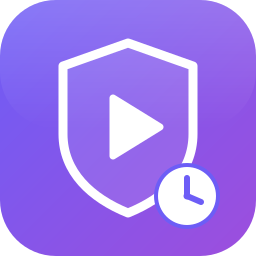
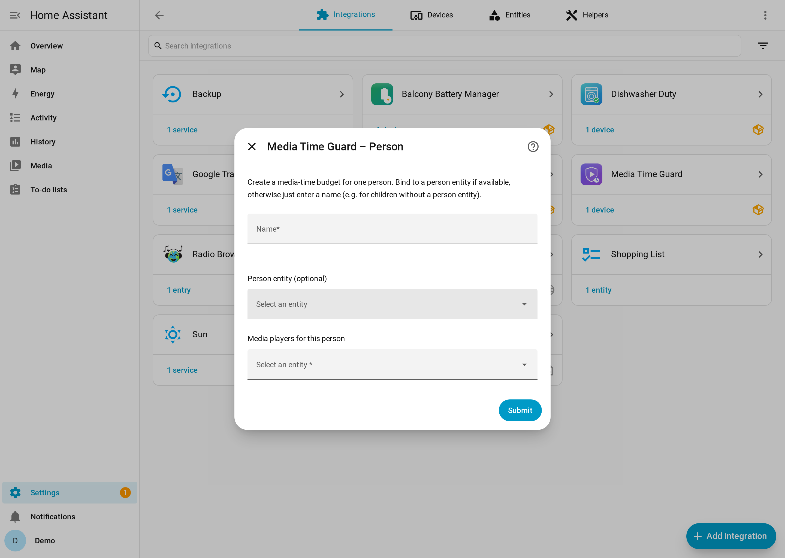
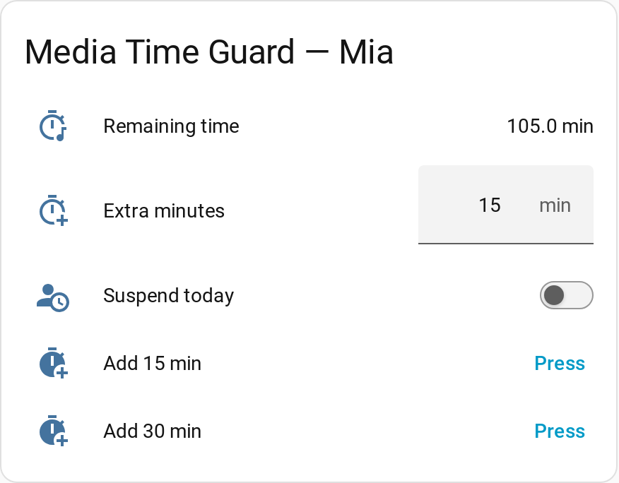

> 🇬🇧 [English](README.md) · 🇩🇪 [Deutsch](README.de.md) · 🇪🇸 Español (esta página)

<p align="center">
  
</p>

<h1 align="center">Media Time Guard</h1>

<p align="center">
  <b>Un presupuesto diario de tiempo multimedia por niño para tus reproductores de Home Assistant: cuenta la reproducción, avisa antes del final y detiene la música cuando se acaba el tiempo.</b>
</p>

<p align="center">
  <a href="https://github.com/hacs/integration"></a>
  <a href="https://github.com/Jo-Highness/media_time_guard/actions/workflows/validate.yml"></a>
  <a href="https://github.com/Jo-Highness/media_time_guard/actions/workflows/test.yml"></a>
  <a href="https://github.com/Jo-Highness/media_time_guard/releases"></a>
  <a href="LICENSE"></a>
  
</p>

## Inicio rápido

1. **Instala** con HACS: [](https://my.home-assistant.io/redirect/hacs_repository/?owner=Jo-Highness&repository=media_time_guard&category=integration) → **Descargar** → reinicia Home Assistant.
2. **Añade** la integración: **Ajustes → Dispositivos y servicios → Añadir integración → Media Time Guard**.
3. **Introduce un nombre** (p. ej. `Luke`), **elige los reproductores del niño** y fija los minutos por día de la semana.
4. **Listo:** `sensor.media_time_luke_remaining` muestra ahora los minutos restantes. Inicia la reproducción en uno de los reproductores y verás la cuenta atrás; al llegar a 0, los reproductores se detienen.

Repite los pasos 2–3 para cada niño (una entrada por niño).

## Qué hace

- ⏱️ **Un presupuesto por día de la semana** – corto entre semana, más largo el fin de semana (`0` = sin multimedia ese día).
- ⏹️ **Detiene la reproducción cuando se agota el presupuesto** – y la vuelve a detener si se reanuda en un reproductor asignado, también tras apagar/encender el altavoz o reiniciar Home Assistant (el estado se guarda).
- 🔀 **Sin doble conteo** – si suenan dos altavoces del niño a la vez, el tiempo cuenta una vez (tiempo de reloj).
- 🔔 **Aviso antes del final** – un **anuncio TTS** único ("quedan 10 minutos …") o tu propio sonido.
- ➕ **Minutos extra** – con botones (+15/+30), una entidad numérica o una acción.
- 🤒 **Excepciones** – ¿el niño está enfermo? Suspende el control por hoy con un interruptor.
- 🌍 **Interfaz multilingüe** – español, inglés, alemán, francés, noruego, griego y japonés.
- 🧩 **Configuración desde la interfaz, totalmente local** – sin YAML, sin nube.

### Qué se cuenta – y qué no puede controlar

Solo se cuenta el tiempo en el que al menos un reproductor asignado informa el estado **`playing`**.
`paused`, `buffering`, `idle`, `on`, `standby`, `off` y `unavailable` **no** cuentan.

Ten en cuenta que es una herramienta de comodidad, no un bloqueo total:

- Solo ve y detiene las entidades `media_player` asignadas. Otros dispositivos, apps que no
  están en Home Assistant o reproductores que nunca informan `playing` (algunos televisores solo
  informan `on`) no quedan cubiertos.
- Para detener se usa `media_player.media_stop`; un reproductor que no lo admite o está
  desconectado no se puede detener (los fallos se registran).
- Cualquiera con acceso a la interfaz de Home Assistant puede dar minutos extra o suspender el control.
- La reproducción silenciada o muy baja también cuenta, porque el reproductor está en `playing`.

## Capturas de pantalla

> Tomadas en una instancia de demostración con datos ficticios.

| Configuración (versión 1.1 – el campo "Entidad de persona" ya no existe) | Tarjeta de entidades en uso |
|:---:|:---:|
|  |  |

## Instalación

### HACS (recomendado)

1. Usa el botón **Abrir en HACS** de arriba o, en **HACS → ⋮ → Repositorios personalizados**, añade
   `https://github.com/Jo-Highness/media_time_guard` con el tipo **Integración**.
2. Busca **Media Time Guard** y **descárgalo**.
3. **Reinicia** Home Assistant.

### Manual

1. Copia `custom_components/media_time_guard/` en tu carpeta `<config>/custom_components/`.
2. **Reinicia** Home Assistant.

Requiere **Home Assistant 2025.2** o posterior.

## Configuración

Una entrada **por niño**. La configuración y los cambios posteriores (**Configurar** en la entrada) usan los mismos cuatro pasos:

| Paso | Qué configuras |
|---|---|
| **1 · Persona** | Un **nombre** (p. ej. `Luke`, debe ser único) y los **reproductores** asignados. Cada reproductor pertenece a una sola persona. |
| **2 · Presupuestos diarios** | Minutos para cada día **lun–dom**. `0` bloquea la multimedia todo el día. |
| **3 · Aviso** | Activar/desactivar, el **umbral de minutos restantes** (por defecto `10`) y el **método**: un anuncio **TTS** (motor TTS + texto, `{minutes}` se sustituye; deja el texto vacío para usar el texto predeterminado en el idioma de Home Assistant) **o** un ID de contenido **multimedia** (+ tipo de contenido, por defecto `music`). |
| **4 · Reinicio** | La **hora de reinicio** diaria (por defecto `00:00:00`). Entonces se reinician contadores, bloqueo, suspensión y aviso. |

Los campos opcionales (motor TTS, texto, ID/tipo multimedia) se pueden vaciar de nuevo en las opciones.
Si aumentas un presupuesto en las opciones, un bloqueo activo se levanta en seguida si queda tiempo.

## Entidades

Cada persona obtiene un **dispositivo** (con su nombre) con estas entidades. `<person>` es el
slug del nombre en el momento de crear la entrada, p. ej. `luke`:

| Entidad | Tipo | Propósito |
|---|---|---|
| `sensor.media_time_<person>_remaining` | sensor (duración, min) | Minutos restantes hoy, con atributos (ver abajo). |
| `switch.media_time_<person>_suspend_today` | interruptor | **Suspender hoy** – sin bloqueo ni detención el resto del día (el tiempo se sigue contando). |
| `number.media_time_<person>_extend` | número (0–600, paso 5, min) | **Minutos extra** de hoy (valor absoluto). |
| `button.media_time_<person>_extend_15` | botón | **+15 minutos**. |
| `button.media_time_<person>_extend_30` | botón | **+30 minutos**. |

Atributos del sensor: `budget_minutes`, `effective_budget_minutes`, `used_minutes`,
`remaining_minutes`, `extra_minutes_today`, `weekday` (0 = lunes), `is_playing`, `is_locked`,
`is_suspended`, `warned_today`, `last_reset`, `players`.

**ID de entidad y cambios de nombre.** Los ID de entidad se crean una vez y luego los conserva
el registro de entidades de Home Assistant. Si **cambias el nombre de la persona** en las
opciones, cambian el nombre del dispositivo, el título de la entrada y los *nombres* de las
entidades, pero los *ID* se mantienen (p. ej. siguen con `…_luke_…`), así que tus
automatizaciones siguen funcionando. Si quieres ID nuevos, cámbialos tú en los ajustes de cada entidad.
Si **renombras o sustituyes un reproductor o una entidad TTS**, la asignación no se actualiza
sola: Media Time Guard crea un **problema de reparación** en *Ajustes → Reparaciones*; abre
**Configurar** en la entrada y elige la entidad actual.

## Acciones (servicios)

Cada acción se dirige a una persona, con **`person`** (nombre o slug, sin distinguir
mayúsculas) o con **`config_entry_id`** (sigue siendo válido tras cambiar el nombre). Uno de los dos es obligatorio.

| Acción | Campos | Descripción |
|---|---|---|
| `media_time_guard.extend_time` | `person` / `config_entry_id`, `minutes` (1–600) | Añade minutos extra para hoy. |
| `media_time_guard.suspend_today` | `person` / `config_entry_id`, `suspended` (bool) | Suspende o reanuda el control por hoy. |
| `media_time_guard.reset_person` | `person` / `config_entry_id` | Reinicia contadores, bloqueo, minutos extra y suspensión de hoy. |

## Ejemplos de automatización

**Premiar con 15 minutos al terminar los deberes:**

```yaml
automation:
  - alias: "Premio multimedia al terminar los deberes"
    triggers:
      - trigger: state
        entity_id: input_boolean.luke_homework_done
        to: "on"
    actions:
      - action: media_time_guard.extend_time
        data:
          person: Luke
          minutes: 15
```

**Suspender el control un día de enfermedad:**

```yaml
automation:
  - alias: "Suspender el límite multimedia si está enfermo"
    triggers:
      - trigger: state
        entity_id: input_boolean.luke_sick
        to: "on"
    actions:
      - action: media_time_guard.suspend_today
        data:
          person: Luke
          suspended: true
```

**Notificar al móvil cuando se agota el presupuesto:**

```yaml
automation:
  - alias: "Notificar cuando se acaba el tiempo multimedia"
    triggers:
      - trigger: state
        entity_id: sensor.media_time_luke_remaining
        attribute: is_locked
        to: true
    actions:
      - action: notify.mobile_app_movil_padres
        data:
          message: "El tiempo multimedia de Luke para hoy se ha agotado."
```

Sustituye `notify.mobile_app_movil_padres` por tu propia acción de notificación.

## Tarjeta de panel de ejemplo

```yaml
type: vertical-stack
cards:
  - type: gauge
    entity: sensor.media_time_luke_remaining
    name: Luke – tiempo multimedia restante
    min: 0
    max: 120
    severity:
      green: 30
      yellow: 10
      red: 0
  - type: entities
    entities:
      - entity: number.media_time_luke_extend
      - entity: switch.media_time_luke_suspend_today
      - entity: button.media_time_luke_extend_15
      - entity: button.media_time_luke_extend_30
```

## Solución de problemas / FAQ

**La reproducción no se detiene aunque el presupuesto esté agotado.**
Comprueba que los reproductores del niño estén asignados en la entrada, que informen `playing`
al reproducir (ver *Herramientas para desarrolladores → Estados*) y que admitan "detener".
Busca un problema de reparación sobre entidades que faltan. `0` minutos significa "bloqueado todo el día".

**Se cuenta tiempo aunque no se oye nada.**
El conteo se basa en el estado `playing`, así que la reproducción silenciada también cuenta.

**El mismo niño usa dos altavoces: ¿se cuenta dos veces?**
No, el tiempo cuenta una vez mientras al menos un reproductor asignado esté sonando.

**Un reproductor no se puede asignar a un segundo niño.**
Es intencionado: cada `media_player` pertenece exactamente a una persona.

**El aviso nunca suena.**
Para **TTS** hace falta un motor TTS; para **multimedia**, un ID de contenido. El aviso suena
una vez cuando el tiempo restante llega al umbral; si unos minutos extra vuelven a subir el
tiempo restante por encima del umbral, sonará otra vez antes del nuevo final.

**Activar el registro de depuración:**

```yaml
logger:
  logs:
    custom_components.media_time_guard: debug
```

Los diagnósticos (sin nombres ni ID de entidad) se descargan desde el menú ⋮ de la entrada.

Más: guías en [`docs/user/`](docs/user) (de, en, es, fr, nb, el, ja) y la arquitectura en
[`docs/TECHNICAL.md`](docs/TECHNICAL.md).

## Contribuir

Las contribuciones son bienvenidas. Lee [`CONTRIBUTING.md`](CONTRIBUTING.md) y abre un issue o
pull request en [GitHub](https://github.com/Jo-Highness/media_time_guard).

## Licencia

Publicado bajo la [licencia MIT](LICENSE).

## Créditos

Creado y mantenido por [@Jo-Highness](https://github.com/Jo-Highness).
Integración personalizada de [Home Assistant](https://www.home-assistant.io/) para
[HACS](https://hacs.xyz/).
